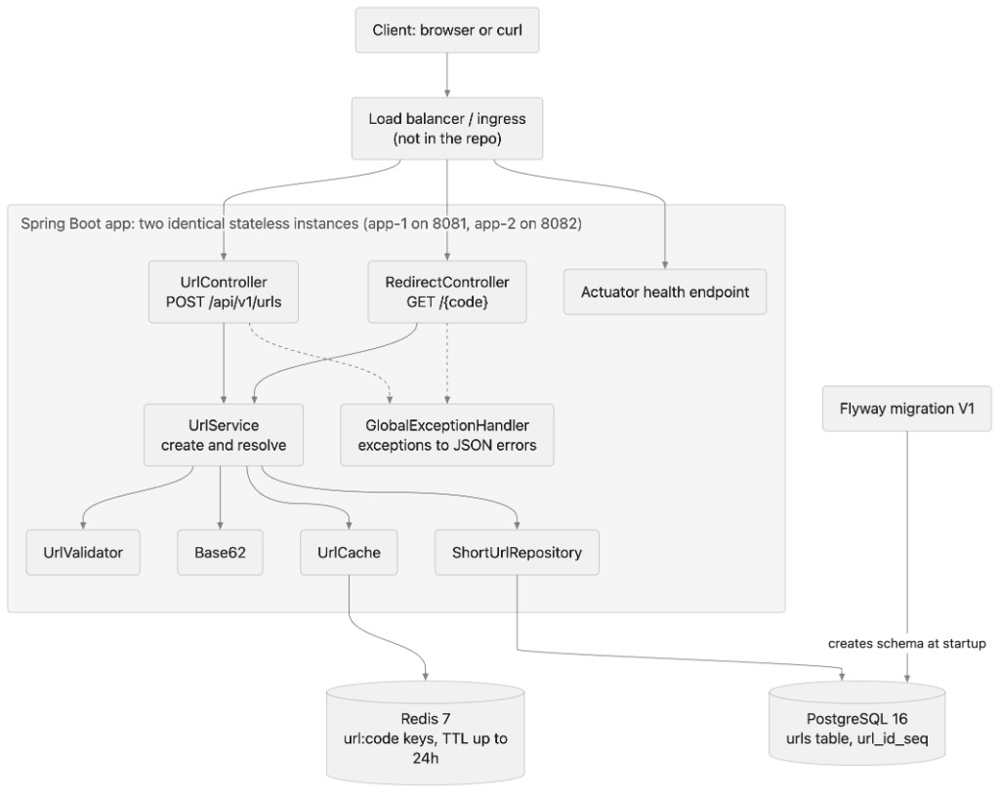

# URL Shortener

## What it does

- Creates compact Base62 short links for valid HTTP and HTTPS URLs.
- Redirects from either application instance with `302 Found`.
- Supports custom aliases, expiry, PostgreSQL persistence, and Redis caching.

## Live URL

Not deployed yet. The application is prepared for DigitalOcean App Platform deployment.

## Architecture

```text
                         +------------------+
                         | Client / Browser |
                         +--------+---------+
                                  |
                           HTTPS / JSON
                                  |
                         +--------v---------+
                         | Load Balancer    |
                         +----+--------+----+
                              |        |
                         +----v--+  +--v----+
                         | App 1 |  | App 2 |
                         +---+---+  +---+---+
                             |          |
                   +---------+----------+---------+
                   |                              |
          +--------v---------+          +---------v--------+
          | PostgreSQL 16    |          | Redis 7          |
          | Source of truth  |          | Rebuildable cache|
          +------------------+          +------------------+
```

Both stateless Spring Boot instances use the same PostgreSQL database and Redis cache.

## High-level design



- **Create** (`POST /api/v1/urls`): `UrlController` calls `UrlService`, which validates the request with `UrlValidator`, takes the next `url_id_seq` value, encodes it with `Base62`, and inserts through `ShortUrlRepository`. A code that is already taken is skipped by the database (`ON CONFLICT DO NOTHING`), not by an exception.
- **Redirect** (`GET /{code}`): `RedirectController` calls `UrlService`, which reads `UrlCache` (Redis) first and falls back to PostgreSQL on a miss or Redis failure. Each successful redirect increments `click_count` atomically in PostgreSQL.
- **Errors**: `GlobalExceptionHandler` turns exceptions into consistent JSON errors (`400`, `404`, `409`, `410`, `500`).
- **Health** (`GET /health`): reports PostgreSQL only, because Redis is a fail-open cache.
- **Schema**: Flyway applies `V1__create_urls.sql` at startup; Hibernate only validates it.

## Key design decisions

| Decision | Choice | Trade-off |
|---|---|---|
| ID generation | PostgreSQL sequence followed by Base62 encoding | Simple and collision-free for generated codes, but exposes approximate creation order |
| Redirect status | `302 Found` by default; `301` only when the creator sets `redirectType: "permanent"` | `302` keeps hit counting and deactivation effective; a cached `301` can bypass both for clients that already cached it |
| Ownership | One-time 256-bit management token returned at creation; only its SHA-256 hash is stored | No user accounts needed; a lost token cannot be recovered or reissued |
| Deactivation | Sets `active = false` and keeps the row | The alias stays reserved and metadata and hit count are preserved; inactive links return `410` |
| Caching | Redis cache-aside with a maximum 24-hour TTL | Fast redirects while PostgreSQL remains authoritative |
| Redis failure | Log a warning and read from PostgreSQL | Redirects remain available, with temporarily higher database load |
| Custom aliases | Database uniqueness constraint | Strong cross-instance consistency; duplicate aliases return `409` |
| Expiry | Stored in PostgreSQL and embedded in cached values | Correct across instances; expired links return `410` |

Generated-code allocation retries up to three times because a custom alias may occupy a future Base62 sequence value.

## API

### Create a generated short URL

```bash
curl -i -X POST http://localhost:8081/api/v1/urls \
  -H 'Content-Type: application/json' \
  -d '{"url":"https://example.com/a/very/long/path"}'
```

Example `201 Created` response:

```json
{
  "code": "1000",
  "shortUrl": "http://localhost:8081/1000",
  "originalUrl": "https://example.com/a/very/long/path",
  "createdAt": "2026-11-21T08:30:00.123456Z",
  "expiresAt": null,
  "hitCount": 0,
  "active": true,
  "redirectType": "temporary",
  "managementToken": "Zq3k...43 URL-safe characters..."
}
```

`managementToken` is returned only once. Store it to deactivate the link later; it never appears in metadata, short URLs, or logs.

### Create a custom alias with expiry and a permanent redirect

```bash
curl -i -X POST http://localhost:8081/api/v1/urls \
  -H 'Content-Type: application/json' \
  -d '{"url":"https://example.com","alias":"my-sale","expiresInDays":30,"redirectType":"permanent"}'
```

Alias rules: 4–30 characters using letters, numbers, `_`, or `-`; `api`, `actuator`, and `health` are reserved.

`redirectType` is optional: `temporary` (default, `302`) or `permanent` (`301`). Use `permanent` only for links that will never be deactivated, because browsers may cache a `301` and skip the service.

### Follow a short URL

```bash
curl -i http://localhost:8082/my-sale
```

Expected: `302 Found` (or `301 Moved Permanently` for permanent links) with the original URL in the `Location` header. Each successful redirect increments `hitCount` once.

### Read metadata

```bash
curl -s http://localhost:8081/api/v1/urls/my-sale
```

Returns `code`, `shortUrl`, `originalUrl`, `createdAt` (UTC, ISO-8601), `expiresAt`, `hitCount`, `active`, and `redirectType`. Reading metadata does not change `hitCount`.

### Deactivate a link (owner only)

```bash
curl -i -X PATCH http://localhost:8081/api/v1/urls/my-sale \
  -H 'Content-Type: application/json' \
  -H "Authorization: Bearer $MANAGEMENT_TOKEN" \
  -d '{"active":false}'
```

Returns `200 OK` with the updated metadata. The link then returns `410 Gone`, keeps its metadata and hit count, and its alias cannot be reused. Repeating the request returns the same inactive state. Reactivation is not supported. Links created before management tokens existed have no owner and cannot be deactivated through the API.

### Error responses

| Condition | Status |
|---|---:|
| Invalid URL, alias, expiry, redirect type, or update body | `400` |
| Missing or malformed `Authorization: Bearer` header | `401` |
| Management token does not own the link | `403` |
| Unknown code | `404` |
| Duplicate alias, including an inactive link's alias | `409` |
| Expired link (`expired`) or deactivated link (`inactive`) | `410` |
| Unexpected server error | `500` |

Errors use:

```json
{
  "error": "invalid_request",
  "message": "URL must be an absolute HTTP or HTTPS URL with a host"
}
```

## Run locally

Requirements: Docker with Docker Compose.

```bash
docker compose up --build -d
docker compose ps
```

| Service | Address |
|---|---|
| App instance 1 | http://localhost:8081 |
| App instance 2 | http://localhost:8082 |
| PostgreSQL | localhost:5432 |
| Redis | localhost:6379 |

Check health:

```bash
curl -s http://localhost:8081/health
curl -s http://localhost:8082/health
```

Expected: `200 OK` with `"status":"UP"`. Health reflects PostgreSQL only; a Redis outage does not fail it because Redis is a fail-open cache.

Stop the stack:

```bash
docker compose down
```

Use `docker compose down -v` only when you intentionally want to delete local database and cache data.

## Run tests

Unit tests:

```bash
./mvnw -q test -Dtest='Base62Test,UrlValidatorTest,UrlServiceTest'
```

PostgreSQL concurrency integration test:

```bash
./mvnw -q test -Dtest=ConcurrencyIntegrationTest
```

The integration test requires Docker and uses PostgreSQL 16 through Testcontainers. Additional manual scenarios are documented in [`Tests/TESTING.md`](Tests/TESTING.md).

## Deploy to DigitalOcean

1. Create a DigitalOcean App Platform app from this repository and select the `Patil-Main` branch.
2. Deploy the root `Dockerfile` as a web service.
3. Attach managed PostgreSQL 16 and Redis 7 services.
4. Configure the following runtime variables:

| Variable | Value |
|---|---|
| `DATABASE_URL` | PostgreSQL JDBC connection URL |
| `REDIS_URL` | Redis connection URL |
| `BASE_URL` | Public application URL |
| `PORT` | Supplied by App Platform |

5. Configure the health endpoint as `/health`.
6. Deploy, then run the create and redirect smoke tests above.

Keep database and Redis credentials in DigitalOcean secrets, never in source control.

## Load test results

Measured results are pending because Docker is unavailable in the current build environment.

The committed integration test starts 100 requests simultaneously and asserts:

| Assertion | Expected |
|---|---:|
| `201 Created` responses | 100 |
| Distinct short codes | 100 |
| PostgreSQL rows | 100 |

Run the same load across both local instances:

```bash
seq 1 100 | xargs -P 50 -I{} sh -c 'p=$((8081 + ({} % 2))); curl -sS -X POST "http://localhost:$p/api/v1/urls" -H "Content-Type: application/json" -d "{\"url\":\"https://example.com/concurrent/{}\"}"; echo' | grep -oE '"code":"[^"]+"' | cut -d'"' -f4 | sort -u | wc -l
```

Expected unique-code count: `100`.

## What I would do next

- Allocate blocks of sequence IDs to reduce database round trips.
- Scramble generated IDs before Base62 encoding to hide creation order.
- Rate-limit `POST /api/v1/urls`.
- Send click events to an asynchronous analytics pipeline.
- Add malware and phishing URL scanning.

## Project documents

- [Requirements](REQUIREMENTS.md)
- [Design (`HIGH_LEVEL_DESIGN.md`, used in place of `DESIGN.md`)](HIGH_LEVEL_DESIGN.md)
- [Progress](PROGRESS.md)
- [Testing guide](Tests/TESTING.md)
